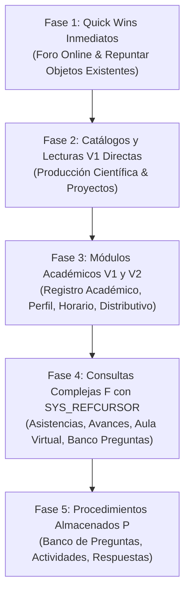

# Plan completo — Migrar queries quemadas a vistas, funciones y procedimientos Oracle (`utn-movil-portafolio-docentes`)

**Fecha:** 2026-09-16  
**Destino de este documento:** `%USERPROFILE%\Documents\Obsidian Vault\Backup-Planes\2026-09-16 - Plan completo migracion queries a vistas y procedimientos (portafolio-docentes).md`  
**Para qué sirve esta nota:** es el **backup maestro de planificación**, redactado de forma exhaustiva para que se pueda abrir en una sesión totalmente limpia y continuar la ejecución técnica sin tener que volver a auditar ni una sola línea SQL del backend de docentes. Contiene el análisis sentencia por sentencia de las **242 consultas y bloques SQL** del repositorio, categorizados con el mismo filtro riguroso acordado para `portafolio-estudiante`.

Documento complementario de referencia en este vault:
- [[2026-09-14 - Plan completo migracion SELECT a vistas (portafolio-estudiante)]] (Plan base de estudiantes, 100% probado y finalizado).

---

## 0. El encargo y contexto en una frase

En `utn-movil-portafolio-docentes` existen **242 sentencias SQL** escritas literalmente (*hardcoded*) en TypeScript. Si el DBA altera una tabla, columna o índice en Oracle, el backend falla inmediatamente en producción sin previo aviso. La tarea es trasladar esta lógica a objetos encapsulados de base de datos en el esquema `MOVIL_UTN` (vistas, funciones con `SYS_REFCURSOR` y procedimientos almacenados), logrando desacoplar el código TypeScript del esquema relacional subyacente.

---

## 1. Decisión de alcance y reglas de filtrado (Mismo criterio de Claude para Estudiante)

Siguiendo la directriz explícita del usuario:
> *"No haré las triviales, ya está resuelto tampoco haré, código muerto tampoco. Audita las queries que existen en docente. No te saltes ninguna y aplica el mismo filtro que hicimos con claude para crear un archivo donde vas a poner cuales toca cambiar en el repo."*

### A. Lo que SÍ se migra en el repo:
1. **V1 — Vista directa (72 sentencias):** El filtro bind solo actúa sobre columnas simples en un `WHERE`. Se traslada el SQL a una vista en `MOVIL_UTN` y el backend ejecuta `SELECT ... FROM MOVIL_UTN.MVL_VIEW_* WHERE columna = :bind`.
2. **V2 — Vista con reescritura (29 sentencias):** Requiere reescribir un fragmento del SQL (p. ej., transformar subconsultas escalares `cuenta → cédula` en `JOIN` con `INS_TAB_USUARIOS`, alinear proyecciones en ramas `UNION`, o eliminar duplicados/agrupaciones inline).
3. **F — Función con `SYS_REFCURSOR` (16 sentencias):** Imposible de resolver en una vista estándar sin romper la lógica o el plan de ejecución (binds dentro de expresiones `CASE` en la proyección `SELECT`, binds dentro de `CONNECT BY PRIOR`, binds dentro de funciones agregadas como `MAX(FUN(...))`, o binds en subconsultas correlacionadas `LEFT JOIN`). Se encapsulan en funciones PL/SQL retornando cursor.
4. **P / W — Procedimiento Almacenado / Escritura (29 sentencias):** Operaciones de modificación (`INSERT`, `UPDATE`, `DELETE`, `MERGE` o bloques PL/SQL anónimos). Deben encapsularse en `MOVIL_UTN.MVL_PRC_*`.

### B. Lo que queda FUERA de migración (No se crean objetos nuevos):
1. **T — Trivial (42 sentencias):** `SELECT 1 FROM DUAL`, lecturas de 1 sola columna por Primary Key en una sola tabla, o subconsultas `EXISTS` simples. No representan riesgo arquitectónico.
2. **YA — Ya resuelto (39 sentencias):** El código ya consume una vista de `MOVIL_UTN` (`MVL_VIEW_*`), una vista del sistema (`LMS_VIEW_*`), o invoca directamente un procedimiento o función existente (`MVL_PRC_*`, `LMS_PRC_*`, etc.).
3. **M — Código muerto (15 sentencias):** Constantes o archivos con 0 importaciones en el repositorio, o módulos descartados que no están registrados en `app.module.ts` (caso de `foro-online-old`).

---

## 2. Hallazgos Críticos de Seguridad (¡ALERTA MÁXIMA!)

1. **`perfil-docente/repository/queries/hoja_de_vida.query.ts`**:
2. **`perfil-docente/repository/queries/carnet_docente.procedure.ts`**:
3. **`registro-academico/repository/queries/documento-notas-estudiantes.query.ts`**:
   Concatena `&userid=' || (SELECT valor FROM INS_TAB_PARAMETROS WHERE codigo = '00009') || '/' || (SELECT valor FROM INS_TAB_PARAMETROS WHERE codigo = '00010') || '@servidor`.
4. **`parametros-servidor-reportes/repository/queries/parametros-servidor.query.ts`**:
   Expone directamente los valores de usuario y clave (`00009` y `00010`) al frontend.
5. **`aula-virtual/repository/queries/documento-silabo.query.ts` (`SYLLABUS_PDF_URL_QUERY`)**:
   Concatena `&userid=' || (SELECT valor FROM INS_TAB_PARAMETROS WHERE codigo = '00009') || '/' || (SELECT valor FROM INS_TAB_PARAMETROS WHERE codigo = '00010') || '@servidor`.
6. **`control_de_bienes/control_de_bienes.service.ts`**:
7. **`pagos/pagos.service.ts`**:

> [!IMPORTANT]
> **Regla para la migración de queries:**
> 

---

## 3. Resumen Global y Tabla Consolidada por Módulo

Total de sentencias analizadas en `src/`: **242 sentencias**.

| N° | Módulo | Total | V1 (Vista Dir.) | V2 (Vista Rees.) | F (Función) | P (Procedimiento) | T (Trivial) | YA (Resuelto) | M (Muerto) |
|:---|:---|:---:|:---:|:---:|:---:|:---:|:---:|:---:|:---:|
| 1 | `perfil-docente` | 7 | 2 | 3 | 0 | 1 | 1 | 0 | 0 |
| 2 | `horario-docente` | 2 | 0 | 2 | 0 | 0 | 0 | 0 | 0 |
| 3 | `distributivo-docente` | 3 | 0 | 3 | 0 | 0 | 0 | 0 | 0 |
| 4 | `calendario-general` | 2 | 2 | 0 | 0 | 0 | 0 | 0 | 0 |
| 5 | `control_de_bienes` | 3 | 0 | 0 | 0 | 0 | 1 | 2 | 0 |
| 6 | `documentos_directorio` | 2 | 0 | 0 | 0 | 0 | 0 | 1 | 1 |
| 7 | `pagos` | 2 | 0 | 0 | 0 | 0 | 0 | 1 | 1 |
| 8 | `parametros-servidor-reportes` | 1 | 1 | 0 | 0 | 0 | 0 | 0 | 0 |
| 9 | `shared` | 4 | 0 | 0 | 0 | 0 | 2 | 0 | 2 |
| 10 | `validacion_acceso` | 2 | 0 | 0 | 0 | 0 | 0 | 2 | 0 |
| 11 | `config` / `health` | 2 | 0 | 0 | 0 | 0 | 2 | 0 | 0 |
| 12 | `foro-online-old` | 10 | 0 | 0 | 0 | 0 | 0 | 0 | 10 |
| 13 | `foro_online` | 10 | 4 | 0 | 2 | 4 | 0 | 0 | 0 |
| 14 | `revision-respuestas` | 13 | 7 | 0 | 0 | 3 | 2 | 1 | 0 |
| 15 | `registro-academico` | 12 | 5 | 3 | 0 | 0 | 3 | 1 | 0 |
| 16 | `avance-materia` | 13 | 3 | 1 | 3 | 1 | 1 | 4 | 0 |
| 17 | `asistencia-estudiantes` | 19 | 4 | 1 | 2 | 1 | 4 | 7 | 0 |
| 18 | `produccion-cientifica` | 23 | 7 | 6 | 2 | 0 | 8 | 0 | 0 |
| 19 | `proyectos-investigacion` | 22 | 18 | 1 | 0 | 0 | 3 | 0 | 0 |
| 20 | `banco-preguntas` | 33 | 8 | 3 | 2 | 11 | 7 | 2 | 0 |
| 21 | `aula-virtual` | 27 | 8 | 3 | 3 | 2 | 4 | 7 | 0 |
| 22 | `actividad` | 30 | 3 | 3 | 2 | 6 | 4 | 11 | 1 |
| **TOTAL** | **22 módulos** | **242** | **72** | **29** | **16** | **29** | **42** | **39** | **15** |

### Balance de Trabajo Efectivo:
- **Total a migrar en fase de lectura (V1 + V2 + F):** **117 sentencias**.
- **Total a migrar en fase de escritura (P):** **29 sentencias**.
- **Total excluido sin cambios (T + YA + M):** **96 sentencias**.

---

## 4. Inventario Detallado Módulo por Módulo

---

### Módulo 1: `perfil-docente` (7 sentencias)
- **`PERFIL_DOCENTE_QUERY`** (`perfil_docente.query.ts`): **V2**. Subconsulta `cuenta → cedula` sobre `RHU_TAB_PERSONAS`, `INS_TAB_LOCALIDADES`, `RHU_TAB_EMPLEADOS`, `NOM_TAB_DATOS_PERSONALES`. Se reescribe haciendo `JOIN` con `INS_TAB_USUARIOS` para filtrar por `CUENTA`.
- **`TIENE_FOTO_DOCENTE_QUERY`** (`tiene_foto_docente.query.ts`): **V2**. `CASE WHEN FOTO IS NOT NULL` con subconsulta de cuenta a cédula.
- **`CEDULA_DIGITAL_QUERY`** (`cedula_digital.query.ts`): **V1**. `DOC_TAB_DOCUMENTOS` filtrado por `CEDULA` y `TIPO_DOCUMENTO = 'CED'`.
- **`docenteExists`** (`perfil-docente.service.ts`): **T**. QueryBuilder `COUNT(1)` por cédula.

---

### Módulo 2: `horario-docente` (2 sentencias)
- **`CICLO_ACADEMICO_QUERY`** (`ciclos_academicos.query.ts`): **V2**. Vista en línea con `ROW_NUMBER()`, filtra ciclos académicos donde el docente tiene carga horaria activa.
- **`HORARIO_DOCENTE_QUERIES`** (`horario_docente.query.ts`): **V2**. `UNION` entre `ACA_TAB_DETALLES_HORARIOS` y `ACA_TAB_DETAL_HORARIO_MODULOS`. Contraparte docente de `MVL_VIEW_HORARIO_ESTUDIANTE`.

---

### Módulo 3: `distributivo-docente` (3 sentencias)
- **`CICLO_ACADEMICO_DISTRIBUTIVO_QUERY`** (`ciclo_academico_distributivo.query.ts`): **V2**. Subconsulta de cuenta a cédula en `ACA_TAB_DISTRIBUTIVOS`.
- **`DISTRIBUTIVO_ACADEMICO_QUERY`** (`distributivo_academico.query.ts`): **V2**. Llama a `LMS_FUN_CEDULA_USUARIO(:cuenta)` en el `WHERE`. Reescritura a `JOIN` con `INS_TAB_USUARIOS`.
- **`DISTRIBUTIVO_PERSONAL_QUERY`** (`distributivo_personal.query.ts`): **V2**. Horas no académicas (`NIVEL_CODIGO = '00'`).

---

### Módulo 4: `calendario-general` (2 sentencias)
- **`CALENDARIO_GENERAL_QUERY`** (`calendario-general.query.ts`): **V1**. Une `LMS_TAB_ACTIVIDAD_ACADEMICA`, `LMS_TAB_AULAS_VIRTUALES` y materias filtradas por `CEDULA_DOCENTE`.
- **`MATERIAL_ID_CURSO_QUERY`** (`materia-id-curso.query.ts`): **V1**. Consulta de 194 líneas de datos de curso, filtrada por `CEDULA_DOCENTE` e `ID_CURSO`.

---

### Módulo 5: `control_de_bienes` (3 sentencias)
- **`ACTIVOS_QUERY_BASE`** y **`COUNT_ACTIVOS_QUERY_BASE`**: **YA**. Ya consumen `MOVIL_UTN.MVL_VIEW_ACTIVOS_RESPONSABLE`.
- **`FOTO_ACTIVO_QUERY`**: **T**. Búsqueda de BLOB por PK en `ACT_TAB_ACTIVOS`.

---

### Módulo 6: `documentos_directorio` (2 sentencias)
- **`INFORMACION_DOCUMENTO_CONSULTA`**: **M**. Código muerto (0 usos en el repo).
- **`OBTENER_ARCHIVO_BLOB_CONSULTA`**: **YA**. Ya invoca `MOVIL_UTN.MVL_FUN_OBTENER_DOC_DIR`.

---

### Módulo 7: `pagos` (2 sentencias)
- **`PAGOS_QUERY`**: **M**. Código muerto (0 importaciones).
- **`PAGOS_TRANSACCIONES_BASE_QUERY`** / **`COUNT_...`**: **YA**. Ya consumen `MOVIL_UTN.MVL_VIEW_PAGOS_TRANSACCIONES`.

---

### Módulo 8: `parametros-servidor-reportes` (1 sentencia)
- **`PARAMETROS_SERVIDOR_QUERY`**: **V1**. Lee `INS_TAB_PARAMETROS`. ⚠ **Hallazgo de seguridad**: expone usuario y clave de BD al frontend.

---

### Módulo 9: `shared` (4 sentencias)
- **`FOTO_PERSONA_QUERY`**: **T**. Lectura de BLOB por PK en `RHU_TAB_PERSONAS`.
- **`HORAS_MODULARES_QUERY`** y **`HORAS_NO_MODULARES_QUERY`**: **M**. Copias duplicadas en shared que no se usan (las activas residen en `asistencia-estudiantes`).
- **`PAGINATION_QUERY`**: **T**. Fragmento SQL simple (`OFFSET ... FETCH NEXT`).

---

### Módulo 10: `validacion_acceso` (2 sentencias)
- **`VALIDAR_CEDULA_DIGITAL_CONSULTA`**: **YA**. Consume `MOVIL_UTN.MVL_VIEW_VALIDAR_CEDULA_DOC`.
- **`VALIDAR_FOTO_DIGITAL_CONSULTA`**: **YA**. Consume `MOVIL_UTN.MVL_VW_VALIDAR_ACCESO_FOTO`.

---

### Módulo 11: `config` / `health` (2 sentencias)
- **`VALIDAR_ESTADO_APP_QUERY`**: **T**. 1 sola tabla `MVL_TAB_APLICACIONES`.
- **`health.service.ts`**: **T**. `SELECT 1 FROM DUAL`.

---

### Módulo 12: `foro-online-old` (10 sentencias)
- **10 archivos de consulta**: **M**. Todo el módulo es código muerto. No está registrado en `app.module.ts` ni tiene importaciones.

---

### Módulo 13: `foro_online` (10 sentencias)
**¡OPORTUNIDAD DE VICTORIA RÁPIDA!**  
Las 10 queries son idénticas a las migradas en el piloto de `portafolio-estudiante`. Todos los objetos ya existen en Oracle `MOVIL_UTN`:
- `MVL_VIEW_FORO_TIPO` (para `tipo_foro.query.ts`): **V1**.
- `MVL_VIEW_FORO_ACT_ESTADO` (para `actividad_estado.query.ts`): **V1**.
- `MVL_VIEW_FORO_AUTORES` (para `autores_foro.query.ts`): **V1**.
- `MVL_VIEW_FORO_INSTRUC_ACT` (para `instrucciones_actividad.query.ts`): **V1**.
- `MVL_FUN_FORO_GENERAL` (para `mensajes_foro_general.query.ts`): **F**.
- `MVL_FUN_FORO_ACTIVIDAD` (para `mensajes_foro_actividad.query.ts`): **F**.
- `MVL_PRC_CREAR_MENSAJE_FORO`: **P**.
- `MVL_PRC_EDITAR_MENSAJE_FORO`: **P**.
- `MVL_PRC_ELIMINAR_MENSAJE_FORO`: **P**.
- `MVL_PRC_ELIMINAR_FORO`: **P**.
*Acción en docentes:* Solo repuntar el código a los objetos existentes.

---

### Módulo 14: `revision-respuestas` (13 sentencias)
- **`RESPUESTAS_ESTUDIANTE_PREGUNTA_QUERY`**: **V1**. Joins en `LMS_TAB_RESPUESTAS_ESTUDIANTE`.
- **`CUESTIONARIO_QUERY`**: **V1**. `LMS_TAB_ACTIVIDAD_ACADEMICA` por ID.
- **`PREGUNTA_QUERY`**: **V1**. `LMS_TAB_PREGUNTAS` por ID.
- **`ALTERNATIVAS_RESPUESTA_QUERY`**: **V1**. `LMS_TAB_RESPUESTAS` por ID de pregunta.
- **`CALIFICAR_RESPUESTA_QUERY`**: **P**. `UPDATE LMS_TAB_RESPUESTAS_ESTUDIANTE`.
- **`ACTUALIZAR_NOTA_PREGUNTA_QUERY`**: **P**. `UPDATE LMS_TAB_PREGUNTAS_CUESTIONARIO`.
- **`ACTUALIZAR_CALIFICACION_ACTIVIDAD_QUERY`**: **P**. `UPDATE LMS_TAB_ACTIVIDADES_ALUMNOS`.
- **`OBTENER_RESPUESTA_ESTUDIANTE_QUERY`**: **V1**.
- **`OBTENER_PREGUNTA_CUESTIONARIO_QUERY`**: **V1**.
- **`OBTENER_NUMERO_PREGUNTAS_QUERY`**: **T**.
- **`OBTENER_ACTIVIDAD_ALUMNO_QUERY`**: **V1**.
- **`PROCEDIMIENTO_RECALCULAR_EVALUACION`**: **YA**. Ya llama a `UTNDB.LMS_PRC_CALIFICAR_EVALUACION`.
- **`VALIDAR_CURSO_ACTIVIDAD_QUERY`**: **T**. `SELECT 1 FROM DUAL WHERE EXISTS ...`.

---

### Módulo 15: `registro-academico` (12 sentencias)
- **`CREAR_AULA_VIRTUAL_QUERY`**: **YA**. Ya llama a `MOVIL_UTN.MVL_PRC_CREAR_AULA_VIRTUAL`.
- **`CICLO_ACADEMICO_REGISTRO_ACADEMICO_QUERY`**: **V1**.
- **`DETALLE_MATERIA_NOTAS_QUERY`**: **V2**. Subconsulta cuenta a cédula + 11 claves de filtro académico.
- **`ESTUDIANTES_POR_MATERIA_QUERY`**: **V1**. Lista de estudiantes por materia.
- **`LISTA_ESTUDIANTES_FOTO_QUERY`**: **V1**. Lista de estudiantes con indicador `TIENE_FOTO`.
- **`NOTAS_GENERAL_ESTUDIANTES_QUERY`**: **V2**. Subconsultas `IN (SELECT ... FROM ACA_TAB_DETALLE_MATRICULAS)`.
- **`MATERIAS_REGISTRO_ACADEMICO_QUERY`**: **V1**. Materias asignadas al docente.
- **`VALIDAR_ESTADO_AULA_VIRTUAL_QUERY`**: **V1**.
- **`VALIDAR_MATERIA_ACTIVA_QUERY`**: **T**.
- **`VALIDAR_ACCESO_ASISTENCIAS_QUERY`**: **T**. `FROM DUAL`.
- **`VALIDAR_VISIBILIDAD_PORCENTAJES_QUERY`**: **T**. `FROM DUAL`.

---

### Módulo 16: `avance-materia` (13 sentencias)
- **`OBTENER_ESTADO_AVANCE_PROCEDURE`**: **YA**. Consume `MOVIL_UTN.MVL_PRC_ESTADO_AVANCE`.
- **`GUARDAR_AVANCE_QUERY`**: **YA**. Consume `MOVIL_UTN.MVL_PRC_GUARDAR_AVANCE`.
- **`ELIMINAR_AVANCE_QUERY`**: **P**. `DELETE FROM ACA_TAB_AVANCES_CURRICULARES WHERE ROWID = :id`.
- **`AVANCE_SELECT_QUERY`**: **F**. Jerarquía `CONNECT BY PRIOR` con `LEVEL` y binds internos.
- **`CALENDARIO_AVANCE_QUERY`**: **V2**. Agrupación de horas dictadas por fecha.
- **`HORAS_DICTADAS_HOY_QUERY`**: **YA**. Consume funciones existentes `LMS_FUN_HORAS_MATERIA_DIA` y `LMS_FUN_HORAS_AVANCE_DIA`.
- **`FECHA_MINIMA_REGISTRO_ACADEMICO_QUERY`**: **YA**. Consume `LMS_FUN_FECHA_AVANCE_ACTIVA`.
- **`PROCENTAJES_MATERIA_QUERY`**: **V1**.
- **`REGISTRO_AVANCES_MATERIA_QUERY`**: **F**. Selecciona `ROWID` y evalúa binds en funciones PL/SQL.
- **`SELECCION_CONTENIDO_QUERY`**: **F**. Igual a la anterior con filtro de contenido.
- **`VALIDAR_AVANCE_CICLO_QUERY`**: **T**.
- **`VALIDAR_FECHA_HORARIO_QUERY`** y **`VALIDAR_FECHA_MODULOS_QUERY`**: **V1**.

---

### Módulo 17: `asistencia-estudiantes` (19 sentencias)
- **`ELIMINAR_ASISTENCIA_QUERY`**: **YA**. Consume `MOVIL_UTN.MVL_PRC_ELIMINAR_ASIS`.
- **`OBTENER_ESTADO_ASISTENCIA_PROCEDURE`**: **YA**. Consume `MOVIL_UTN.MVL_PRC_ESTADO_ASISTENCIA`.
- **`GUARDAR_ASISTENCIA_NO_MODULAR_QUERY`**: **YA**. Consume `MOVIL_UTN.MVL_PRC_GUARDAR_ASIS_NO_MOD`.
- **`GUARDAR_ASISTENCIA_MODULAR_QUERY`**: **YA**. Consume `MOVIL_UTN.MVL_PRC_GUARDAR_ASIS_MOD`.
- **`CONSULTAR_ASISTENCIA_ESTUDIANTE_PROCEDURE`**: **P**. Bloque PL/SQL anónimo con conteo condicional.
- **`ASISTENCIAS_QUERY`**: **F**. 143 líneas, `MAX(LMS_FUN_REPRUEBA_FALTAS(...))`, `LISTAGG`, agregaciones dinámicas.
- **`ASISTENCIAS_MODULAR_QUERY`**: **F**. Contraparte modular con idéntica complejidad.
- **`ASISTENCIAS_REGISTRADAS_QUERY`**: **YA**. Ya consulta `UTNDB.LMS_VIEW_ASISTENCIA_ESTUDIANTE`.
- **`CALENDARIO_ASISTENCIA_QUERY`**: **V2**. `UNION ALL` de asistencia modular y no modular con `JSON_ARRAYAGG`.
- **`DATOS_MATERIA_QUERY`**: **V1**.
- **`FECHA_MINIMA_ASISTENCIA_QUERY`**: **YA**. Consume `LMS_FUN_FECHA_AVANCE_ACTIVA`.
- **`HORAS_NO_MODULARES_QUERY`** y **`HORAS_MODULARES_QUERY`**: **V1**.
- **`LISTA_ESTUDIANTES_VER_QUERY`**: **V1**.
- **`VALIDAR_CICLO_ACTUAL_QUERY`**, **`VALIDAR_CICLO_INACTIVO_QUERY`**, **`ES_FERIADO_QUERY`**, **`VALIDAR_LISTADO_ASISTENCIAS_QUERY`**: **T**.
- **`VALIDAR_SELECCION_FECHA`**: **YA**. Consume `LMS_FUN_HABILITA_CREAR_AULA`.

---

### Módulo 18: `produccion-cientifica` (23 sentencias)
- **`articulos.query.ts`** (`BASE_ARTICULOS_QUERY` & `COUNT`): **V2**. Join con `RHU_TAB_OBRA_PARTICIPACION` e `INS_TAB_USUARIOS` por `CUENTA`.
- **`libros.query.ts`** (`BASE_LIBROS_QUERY` & `COUNT`): **V2**. Condición `OR (OP.EMPLEADO = USR.PERSONA_CEDULA OR OPT.CEDULA_PARTICIPANTE = USR.PERSONA_CEDULA)`.
- **`capitulos-libro.query.ts`** (`BASE_CAPITULOS_LIBRO_QUERY` & `COUNT`): **V2**.
- **`ponencias.query.ts`** (`BASE_PONENCIAS_QUERY` & `COUNT`): **V2**.
- **`proceedings.query.ts`** (`BASE_PROCEEDINGS_QUERY` & `COUNT`): **V2**.
- **`obras-artisticas.query.ts`** (`BASE_OBRAS_ARTISTICAS_QUERY` & `COUNT`): **V2**.
- **`autores-obra.query.ts`**: **V1**. `RHU_TAB_OBRA_PARTICIPACION` left join `RHU_TAB_PERSONAS`.
- **`conteo-bd-indexada.query.ts`**: **F**. Bind `:cuenta` dentro de subconsulta en `LEFT JOIN` correlacionado.
- **`conteo-tipos-obra.query.ts`**: **F**. Bind `:cuenta` dentro de subconsulta en `LEFT JOIN` contra lista de DUAL.
- **`tipos-obra-artistica.query.ts`**: **V1**. `GROUP BY ART_TIPO_OBRA` sin binds.
- **`detalle-articulo.query.ts`**: **V1**. Joins con catálogos CINE y editoriales por `CODIGO`.
- **`detalle-cap-libro.query.ts`**: **V1**.
- **`detalle-libro.query.ts`**: **V1**.
- **`detalle-obra-artistica.query.ts`**: **V1**.
- **`detalle-ponencia.query.ts`**: **V1**.
- **7 Consultas de Documentos BLOB** (`doc-evidencia`, `doc-imagen`, `doc-informe1-pares`, `doc-informe2-pares`, `doc-publicacion`, `doc-publicaciones`, `doc-senadi`): **T**. Selección de BLOB por PK en `RHU_TAB_OBRAS_PUBLICADAS`.
- **`shared-filters.query.ts`**: **T**. Fragmentos SQL simples de orden y fechas.

---

### Módulo 19: `proyectos-investigacion` (22 sentencias)
- **`proyectos.query.ts`** (`BASE_PROYECTOS_INVESTIGACION_QUERY` & `COUNT`): **V2**. CTE `WITH usuario_cedula` y triple condición OR sobre cédula de participante convertida a join directo.
- **`convocatorias.query.ts`** (`BASE_CONVOCATORIAS_QUERY` & `COUNT`): **V1**. `MGI_TAB_CONVOCATORIA WHERE ESTADO != 'P'`.
- **`detalle-convocatoria.query.ts`**: **V1**. Misma tabla por `CODIGO`.
- **`datos-proyecto.query.ts`**: **V1**. Metadatos de proyecto e infraestructura.
- **`doc-presupuesto.query.ts`**, **`doc-proyecto.query.ts`**, **`doc-resolucion.query.ts`**: **T**. BLOBs por PK en `MGI_TAB_DOCUMENTOS_RESPALDO`.
- **`documentos-urls.query.ts`**: **V1**. Flags `TIENE_PRESUPUESTO`, etc., de documentos.
- **14 Consultas de Catálogos y Componentes**:
  - `acciones-divulgacion.query.ts`: **V1**.
  - `areas-investigacion.query.ts`: **V1**.
  - `beneficiarios.query.ts`: **V1**.
  - `ejes-integradores.query.ts`: **V1**.
  - `equipo-trabajo.query.ts`: **V1**.
  - `equipos-utn.query.ts`: **V1** (`MGI_TAB_INFRAESTRUCTURA TIPO=2`).
  - `laboratorios.query.ts`: **V1** (`MGI_TAB_INFRAESTRUCTURA TIPO=1`).
  - `software.query.ts`: **V1** (`MGI_TAB_INFRAESTRUCTURA TIPO=3`).
  - `estrategias-produccion.query.ts`: **V1**.
  - `estrategias-resultados.query.ts`: **V1**.
  - `instituciones-asociadas.query.ts`: **V1**.
  - `linea-investigacion.query.ts`: **V1**.
  - `objetivos-especificos.query.ts`: **V1**.
  - `sectores-impacto.query.ts`: **V1**.

---

### Módulo 20: `banco-preguntas` (33 sentencias)
#### Escritura / PL-SQL (12 sentencias):
- **`PL-SQL/crear-pregunta.query.ts`**: **P**. Bloque PL/SQL con `INSERT ... RETURNING INTO :12`. Debe ser `MVL_PRC_CREAR_PREGUNTA`.
- **`PL-SQL/crear-respuesta.query.ts`**: **P**. `INSERT INTO LMS_TAB_RESPUESTAS`.
- **`PL-SQL/desactivar-pregunta.query.ts`**: **P**. `UPDATE LMS_TAB_PREGUNTAS SET ESTADO = 'I'`.
- **`PL-SQL/editar-pregunta.query.ts`**: **P**. `UPDATE LMS_TAB_PREGUNTAS` con actualización condicional de BLOB.
- **`PL-SQL/editar-respuesta.query.ts`**: **P**. `UPDATE LMS_TAB_RESPUESTAS`.
- **`PL-SQL/eliminar-varias-respuestas.query.ts`**: **P**. `DELETE ... BULK COLLECT INTO :out_codigos`.
- **`PL-SQL/importar-multiples-preguntas.query.ts`**: **P**. Bucle VARRAY que invoca `MVL_PRC_IMPORTAR_PREGUNTA`.
- **`PL-SQL/importar-preguntas-contenido.query.ts`**: **P**. Bucle cursor que invoca `MVL_PRC_IMPORTAR_PREGUNTA`.
- **`PL-SQL/importar-preguntas-materia.query.ts`**: **P**. Bucle cursor para importar preguntas por materia.
- **`PL-SQL/importar-una-pregunta.query.ts`**: **YA**. Ya invoca directamente `MVL_PRC_IMPORTAR_PREGUNTA`.
- **`crear-multiples-respuestas.query.ts`**: **P**. `INSERT ALL ... SELECT * FROM DUAL`.
- **`eliminar-respuesta.query.ts`**: **P**. `DELETE FROM LMS_TAB_RESPUESTAS WHERE CODIGO = :codigo`.

#### Lectura (21 sentencias):
- **`aula-pregunta.query.ts`**: **T**. 1 tabla, 1 columna por PK.
- **`ciclos-academicos.query.ts`**: **V2**. Filtra ciclos con preguntas existentes y excluye aula actual.
- **`codigos-preguntas-a-importar.query.ts`**: **F**. Pasa `:codAulaDestino` a `UTNDB.LMS_FUN_PREGUNTA_IMPORTADA(...) = 0`.
- **`count-preguntas-a-importar.query.ts`**: **V1**. Conteo de preguntas elegibles.
- **`listado-preguntas-a-importar.query.ts`**: **F**. Bind `:codAulaDestino` evaluado directamente en la expresión `CASE` de la proyección `SELECT`.
- **`contenidos-aula.query.ts`**: **V1**. Joins con `ACA_TAB_CONTENIDOS_MATERIAS`.
- **`contenidos-destino.query.ts`**: **V2**. `UNION` de contenidos de aula con fila sintética de Materia.
- **`contenidos-origen.query.ts`**: **V1**.
- **`imagen-pregunta.query.ts`**: **T**. BLOB por PK en `LMS_TAB_PREGUNTAS`.
- **`listado-preguntas.query.ts`** (`LISTADO` & `COUNT`): **V1**. Lista de preguntas por aula.
- **`listado-respuestas.query.ts`**: **V1**. Alternativas de respuesta por pregunta.
- **`listado-tipo-preguntas.query.ts`**: **V1**. Catálogo activo.
- **`materias.query.ts`**: **V2**. Materias con preguntas activas excluyendo aula destino.
- **`pregunta.query.ts`**: **V1**. Datos de la pregunta por ID.
- **`tipo-de-pregunta.query.ts`**: **V1**. Nombre del tipo de pregunta.
- **`tipo-pregunta.query.ts`**: **T**. Código de tipo por PK.
- **`validar-aula.query.ts`**, **`validar-parciales-activas.query.ts`**, **`validar-pregunta-en-cuestionario.query.ts`**, **`validar-pregunta-inactiva.query.ts`**, **`validar-usuario-pregunta.query.ts`**: **T / YA**. Validaciones de existencia en 1 tabla o llamadas directas a funciones.

---

### Módulo 21: `aula-virtual` (27 sentencias)
#### Escritura / PL-SQL (7 sentencias):
- **`PL-SQL/actualizar-recurso.query.ts`** y **`...-sin-adjunto.query.ts`**: **YA**. Ya consumen `UTNDB.MVL_PRC_ACTUALIZAR_RECURSO`.
- **`PL-SQL/guardar-recurso.query.ts`** y **`...-sin-adjunto.query.ts`**: **YA**. Ya consumen `MOVIL_UTN.MVL_PRC_GUARDAR_RECURSO`.
- **`PL-SQL/eliminar-recurso.query.ts`**: **P**. `UPDATE LMS_TAB_RECURSOS SET ESTADO = 'I'`.
- **`calificaciones/PL-SQL/guardar-calificaciones-query.ts`**: **YA**. Ya consume `MOVIL_UTN.MVL_PRC_GUARDAR_CALIFICACIONES`.
- **`calificaciones/actualizar-calificacion-quey.ts`**: **P**. `UPDATE LMS_TAB_ACTIVIDADES_ALUMNOS`. (Nota: archivo con errata en nombre `actualizar-calificacion-quey.ts`).
- **`notas/PL-SQL/enviar-nota1-query.ts`**: **YA**. Ya consume `UTNDB.LMS_ENVIAR_NOTAS_AULA`.
- **`notas/actualizar-notas-query.ts`**: **YA**. Ya consume `UTNDB.LMS_PRC_ACTUALIZAR_NOTAS_AULA`.

#### Lectura (20 sentencias):
- **`notas/habilitar-notas-query.ts`**: **F**. Pasa `:idCurso` a `LMS_FUN_PARCIAL_ACTIVA_NOTAS` dentro de `CASE`.
- **`actividades.query.ts`**: **V1**. Actividades académicas por curso y parcial.
- **`calendario-materia/calendario-detalle.query.ts`**: **V2**. Actividades con conteo condicional de pendientes.
- **`calificaciones/validar-guardar-calificacion-qury.ts`**: **T**. Validación de parcial activa (errata en nombre `...-qury.ts`).
- **`calificaciones/validar-calificacion-regular.ts`**: **T**. Validación de tipo de evaluación.
- **`calificaciones/decripcion-calificacion-actividad.query.ts`**: **V1**.
- **`calificaciones/lista-estudiantes-actividad.query.ts`**: **V1**. Estudiantes y notas por actividad.
- **`calificaciones/lista-estudiantes-actividad-supletorio.query.ts`**: **F**. Bind `:codigoParcial` evaluado en expresiones `CASE` de proyección y filtros de nota.
- **`contenidos-materia.query.ts`**: **V1**. Contenidos por 9 claves académicas.
- **`detalles_notas_estudiante.query.ts`**: **V2**. CTEs con cálculo de promedio y ponderaciones.
- **`notas/notas-aula-virtual.query.ts`**: **V1**. Sábana de notas de curso por aula.
- **`obtener-recurso-por-id.query.ts`**: **V1**.
- **`parcial-activo-query.ts`**: **YA / T**. `SELECT CASE WHEN LMS_FUN_PARCIAL_ACTIVA_NOTAS ... FROM DUAL`.
- **`parciales-materia.query.ts`**: **V2 / F**. `UNION` con ramas `FROM DUAL` ('Primera Parcial', 'Todo').
- **`recursos-ver-query.ts`**: **V1**. Lista de recursos por aula.
- **`tipos-recurso.query.ts`**: **V1**. Catálogo de tipos de recurso.
- **`validar-habilitar-recurso.query.ts`**: **T**. Validación lógica `FROM DUAL`.

---

### Módulo 22: `actividad` (30 sentencias)
#### Escritura / PL-SQL (11 sentencias):
- **`PL-SQL/agregar-intento-evaluacion.query.ts`**: **YA**. Consume `UTNDB.LMS_PRC_MODIFICAR_INTENTOS`.
- **`PL-SQL/guardar_actividad.query.ts`**: **YA**. Consume `MOVIL_UTN.MVL_PRC_GUARDAR_ACTIVIDAD_DOCENTE`.
- **`actulizar_actividad.query.ts`**: **YA**. Consume `MOVIL_UTN.MVL_PRC_ACTUALIZAR_ACTIVIDAD`.
- **`actualizar_actividad_sinadjunto.query.ts`**: **P**. `UPDATE LMS_TAB_ACTIVIDAD_ACADEMICA`.
- **`crear-actividad-query.ts`**: **YA**. Consume `MOVIL_UTN.MVL_PRC_CREAR_ACTIVIDAD`.
- **`crear-actividad-sin-adjunto.query.ts`**: **P**. `INSERT INTO LMS_TAB_ACTIVIDAD_ACADEMICA`.
- **`evaluacion/PL-SQL/agregar-preguntas-evaluacion.query.ts`**: **P**. Bucle anónimo que inserta preguntas por estudiante. Debe ser `MVL_PRC_AGREGAR_PREGUNTAS_EVAL`.
- **`evaluacion/PL-SQL/sortear-preguntas-evaluacion.query.ts`**: **YA**. Consume `UTNDB.LMS_PRC_SORTEAR_PREGUNTASv2`.
- **`evaluacion/eliminar-cuestionario.query.ts`**: **P**. `DELETE FROM LMS_TAB_PREGUNTAS_CUESTIONARIO`.
- **`evaluacion/eliminar-preguntas-evaluacion.query.ts`**: **P**. `DELETE FROM LMS_TAB_PREGUNTAS_CUESTIONARIO WHERE PREGUNTA_CODIGO IN (...)`.
- **`evaluacion/resetear-tiempo-evaluacion.query.ts`**: **P**. `UPDATE LMS_TAB_ACTIVIDADES_ALUMNOS SET FECHA_INICIO_EA = NULL`.

#### Lectura (19 sentencias):
- **`actividad.query.ts`**: **V1**. Detalle de actividad docente por ID.
- **`contenidos.query.ts`**: **V1**. Contenidos por aula.
- **`evaluacion/curso-actividad.query.ts`**: **T**. `SELECT ID_CURSO FROM LMS_TAB_ACTIVIDAD_ACADEMICA`.
- **`evaluacion/estudiantes-evaluacion.query.ts`**: **F**. Evaluaciones N1/N2 y N3/N4 con filtros de nota condicionales.
- **`evaluacion/num-preguntas-evaluacion.query.ts`**: **YA**. Ya consulta la vista `UTNDB.LMS_VIEW_PREGUNTAS_CONTENIDO`.
- **`evaluacion/preguntas-a-agregar.query.ts`**: **V2**. Conjunto de queries para preguntas disponibles y agregadas.
- **`evaluacion/preguntas-evaluacion.query.ts`**: **V1**. Preguntas asignadas a un estudiante (`COUNT` es **T**).
- **`evaluacion/validar-cuestionario-respuestas-estudiante.query.ts`**: **T**. `EXISTS FROM DUAL`.
- **`evaluacion/validar-evaluacion-ya-sorteada.query.ts`**: **T**. `EXISTS FROM DUAL`.
- **`fecha_de_creacion_actividad.query.ts`**: **T**. 1 tabla por PK.
- **`parcial-activo-query.ts`**: **YA**. Llama a función en DUAL.
- **`parciales.query.ts`**: **V2**. `UNION` idéntica a `aula-virtual`.
- **`politicas-evaluacion.query.ts`**: **F**. Bind `:CODIGO_PARCIAL` dentro de `CASE` de proyección.
- **`tipos-actividad-query.ts`**: **V2**. Filtrado condicional por política de evaluación.
- **`validar-actividad-activa.query.ts`**, **`validar-crear-actividad.query.ts`**, **`validar-editar-actividad-query.ts`**, **`validar-parcial-activo-query.ts`**: **YA / T**. Verificaciones que llaman a `LMS_FUN_PARCIAL_ACTIVA`.
- **`validar_fecha_fin_clase_sincrona.query.ts`**: **M**. Código muerto (0 usos en todo el backend).

---

## 5. Estrategia de Ejecución Recomendada

Para ejecutar esta migración de forma segura, modular y sin bloquear desarrollos, se recomienda seguir estrictamente este orden de fases:

1. **Fase 1 — Repunte Inmediato (Quick Wins):**
   - Módulo `foro_online`: Ya cuenta con todos sus objetos creados en `MOVIL_UTN` (`MVL_VIEW_FORO_*`, `MVL_FUN_FORO_*`, `MVL_PRC_FORO_*`). Solo requiere cambiar las cadenas en el repositorio TypeScript y verificar con `pnpm run build` y `curl`.
2. **Fase 2 — Vistas Directas de Baja Complejidad (V1):**
   - Módulos `produccion-cientifica` (detalles de artículos, libros, ponencias) y `proyectos-investigacion` (catálogos de infraestructura, equipo de trabajo, convocatorias). Son `SELECT` simples con filtros directos sin riesgo de regresión.
3. **Fase 3 — Reescrituras y Resolución de Seguridad (V2):**
   - Módulos `perfil-docente`, `horario-docente`, `distributivo-docente` y `registro-academico`.
4. **Fase 4 — Funciones con `SYS_REFCURSOR` (F):**
   - Módulos con árboles jerárquicos (`avance-materia` con `CONNECT BY`), consultas de asistencia masiva (`asistencia-estudiantes` con `MAX(FUN(...))`), y proyecciones dinámicas con binds en `CASE` (`banco-preguntas`, `actividad`, `aula-virtual`).
5. **Fase 5 — Fase de Procedimientos Almacenados (P):**
   - Encapsular las 29 operaciones de inserción, edición y eliminación (especialmente en `banco-preguntas` y `actividad`) en procedimientos `MVL_PRC_*`.

---

## 6. Verificación y Reglas de Trabajo

1. **Prueba con Curl y Respuesta Idéntica:**  
2. **Sin Errores de Tipos (`pnpm run build`):**  
   Cada paso debe compilar con 0 errores TypeScript.
3. **Respeto a Git y Repositorio:**  
   El repositorio `utn-movil-portafolio-docentes` se mantiene bajo estricto modo de solo lectura durante la etapa de auditoría. Ningún commit o push se ejecuta sin instrucción expresa del usuario.
